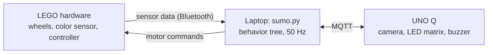

# RQ-D2 Sumo Robot: Laptop Brain

The laptop program is the robot's brain. It connects over **Bluetooth** to the LEGO
Education hardware (Double Motor, Color Sensor, Controller, all on the orange
Connection Card **1131**), runs a **behavior tree** at 50 Hz, and talks to the
**UNO Q** (camera opponent detector, LED matrix, buzzer) over **MQTT**.

**Running `sumo.py` = one round.** The round ends when the robot is out of the ring.

---

## 1. Quick start

All commands run from the repo's `my_env` (Python 3.14). In VS Code, open **Run and
Debug** (Ctrl+Shift+D) and pick a `Sumo: ...` entry instead of typing commands.

| What | VS Code entry | Command (from `Sumo/`) |
|---|---|---|
| Install packages (once) | | `..\my_env\Scripts\python.exe -m pip install -r requirements.txt` |
| Run the tests | Sumo: run automated tests | `..\my_env\Scripts\python.exe -m pytest` |
| Watch a simulated round | Sumo: simulator | `..\my_env\Scripts\python.exe sumo.py --sim --scenario full_round` |
| Measure the robot (no motors) | Sumo: hardware check | `..\my_env\Scripts\python.exe hardware_check.py` |
| Motor direction test (wheels lifted) | Sumo: hardware check + motor spin test | `... hardware_check.py --spin` |
| Teach floor vs. tape | Sumo: calibrate color sensor | `... calibrate_color.py` |
| Dry run (sensors live, wheels never move) | Sumo: dry run | `... sumo.py --no-motors` |
| LEGO only, no MQTT | Sumo: LEGO only | `... sumo.py --no-unoq` |
| **A real round** | **Sumo: ROUND** | `... sumo.py` |

Other options: `--fast` runs the simulator as fast as possible, and `--list-scenarios` lists the scenarios.
Modes can be combined, e.g. `--no-unoq --no-motors`.

**Starting a round:** the program connects, then prints `[armed]`. Center both levers,
then push either lever past 70 %. That push starts the round but does **not** drive
the robot; teleop unlocks once both levers are back at center. (No countdown: the
`COUNTDOWN_S` option exists but is 0, per your choice.)

---

## 2. Files

| File | What it does |
|---|---|
| `sumo.py` | Main program: modes, the 50 Hz loop, shutdown (motors first, always) |
| `config.py` | **Every tunable value** (speeds, times, thresholds, topics, card) |
| `behavior_tree.py` | Tiny behavior-tree library: `Selector`, `Sequence`, `Condition`, `Action`, `Status` |
| `robot_tree.py` | The sumo tree built from those nodes, plus the `Blackboard` (inputs) |
| `line_tracker.py` | Line-crossing state machine: inside / on the edge / out |
| `motion.py` | Which way are we *really* moving? Wheel encoders + IMU fusion |
| `color_classifier.py` | Floor-vs-tape: KNN or the sensor's own color (`COLOR_METHOD`) + debouncer |
| `vision.py` | Opponent message parsing, freshness rules, chase steering math |
| `round_start.py` | armed → running, and the "re-center before teleop" lock |
| `mqtt_link.py` | Laptop side of the MQTT messages |
| `lego_io.py` | Bluetooth: devices, non-blocking motor sender thread, reconnects |
| `watchdogs.py` | Warnings: Controller driving motors directly; wrong wheel-sign config |
| `simulator.py` | Fake ring + sensors + UNO Q for `--sim` and tests (12 scenarios) |
| `calibrate_color.py` | Record floor/tape samples → `color_samples.json`; live test compares both methods |
| `hardware_check.py` | Measures the `MEASURE` values in `config.py` |
| `tests/` | 128 automated tests (`pytest`) |

---

## 3. Architecture

Every tick (50 times a second) the laptop reads the sensors, runs the behavior tree to
decide what to do, and sends one motor command. Motor commands and MQTT each run on
their own thread, so the main loop never waits on Bluetooth or the network.

---

## 4. The behavior tree

Every tick the branches are checked top to bottom, and the **first one whose condition
is true runs**. A higher branch can always interrupt a lower one.

| # | If... | Then... |
|---|---|---|
| 0 | Robot is out of the ring | Stop, tell the UNO Q (sad song), exit |
| 0b | Color sensor data is stale | Stop (we can't see the edge) |
| 1 | Sensor sees the blue tape while moving forward | Drive backward for 1 s |
| 2 | Camera sees the opponent | Steer toward it (faster when close and centered) |
| 3 | A Controller lever is pushed | Tank drive: each lever drives its wheel |
| 4 | Nothing else | Stop and wait |

The tree is built from a small library written from scratch (`behavior_tree.py`).
Branch changes print as `[tree] t=  3.14s  branch: teleop -> reverse`.

---

## 5. Out of the ring: the line-crossing logic

The floor looks the same inside and outside the ring, so one reading can't tell where
the robot is. Instead, `line_tracker.py` looks at **which way the robot was moving when
the color sensor (at the front) crossed the tape**:

| Sensor sees tape while... | Meaning | Result |
|---|---|---|
| moving **forward** | Front reached the edge | Reverse (branch 1) |
| moving **backward** | Sensor is the last part over the line, so the whole robot is past it | **Out** |
| moving forward, then floor again (still forward) | Front crossed the whole line | **Out** |
| moving forward, then floor again moving backward | Backed off the line | Still inside |

- **Which way are we moving?** `motion.py` combines wheel encoders with the IMU, so it
  stays correct when the robot is pushed and its wheels slip.
- **Floor or tape?** `color_classifier.py` uses a KNN trained with `calibrate_color.py`, or
  the sensor's own color name (`COLOR_METHOD` in `config.py`). A change needs 2 matching
  readings in a row, so one bad reading can't end the round.

---

## 6. MQTT messages

Broker `test.mosquitto.org:1883`. Every topic starts with `ME193/Rogers/RQ-D2/`.

| Topic | From → to | What it's for |
|---|---|---|
| `vision/opponent` | UNO Q → laptop | Where the opponent is in the camera image and how far away. Drives the chase branch |
| `unoq/status` | UNO Q → laptop | Is the UNO Q online and is its camera working? |
| `laptop/status` | laptop → UNO Q | Is the laptop brain online? |
| `robot/state` | laptop → UNO Q | Current phase (`armed` / `running` / `lost`) and branch, sent when it changes |
| `event/lost` | laptop → UNO Q | Robot left the ring: play the sad song |
| `event/song_done` | UNO Q → laptop | Song finished: the laptop can exit |

If vision is old, the broker is down, or the UNO Q is offline, the chase branch just
doesn't run. The Controller and the edge reflex keep working without MQTT.

---

## 7. Safety and failures

- **Out of the ring or color sensor stale:** the robot stops (branches 0 and 0b).
- **Any exit (Ctrl+C, crash):** motors are always stopped first.
- **LEGO device disconnects:** it reconnects in the background and ignores old data.
- **MQTT or UNO Q down:** only the chase branch is lost; driving and the edge reflex still work.
- **Controller driving the motors directly:** a watchdog prints a warning. If you see it,
  move the Controller to a different Connection Card.

---

## 8. Measuring and calibrating

1. `hardware_check.py`: measures wheel direction, speed scaling and IMU axes, and prints
   values to paste into `config.py`. Add `--spin` (wheels lifted) to check motor directions.
2. `calibrate_color.py`: records floor and tape samples into `color_samples.json` for the
   KNN, and lets you compare it live with the sensor's own color name.
3. Measure the tape width with a ruler and set `TAPE_WIDTH_M`.

---

## 9. Testing

`pytest` runs 128 tests in about 4 s with no hardware. They cover every behavior-tree
priority, every line-crossing case, motion direction, color classification, vision
rules, the MQTT topics, and 12 full simulated rounds.

Run one simulated round with `--sim --scenario NAME`, and list them with `--list-scenarios`.
