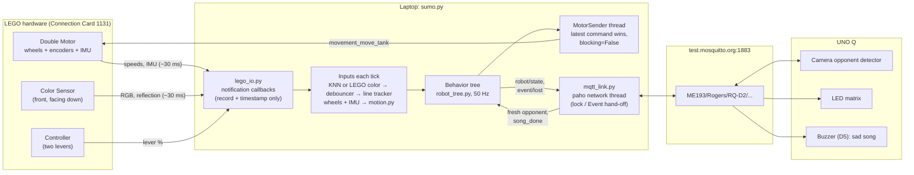

# RQ-D2 Sumo Robot: Laptop Brain

The laptop program is the robot's brain. It connects over **Bluetooth** to the LEGO
Education hardware (Double Motor, Color Sensor, Controller, all on the orange
Connection Card **1131**), runs a **behavior tree** at 50 Hz, and talks to the
**UNO Q** (camera opponent detector, LED matrix, buzzer) over **MQTT**.

**Running `sumo.py` = one round.** The round ends when the robot is out of the ring.

---

## 1. Quick start

All commands run from the repo's `my_env` (Python 3.14). In VS Code, open **Run and
Debug** (Ctrl+Shift+D) and pick a `Sumo: ...` entry instead of typing commands.

| What | VS Code entry | Command (from `Sumo/`) |
|---|---|---|
| Install packages (once) | | `..\my_env\Scripts\python.exe -m pip install -r requirements.txt` |
| Run the tests | Sumo: run automated tests | `..\my_env\Scripts\python.exe -m pytest` |
| Watch a simulated round | Sumo: simulator | `..\my_env\Scripts\python.exe sumo.py --sim --scenario full_round` |
| Measure the robot (no motors) | Sumo: hardware check | `..\my_env\Scripts\python.exe hardware_check.py` |
| Motor direction test (wheels lifted) | Sumo: hardware check + motor spin test | `... hardware_check.py --spin` |
| Teach floor vs. tape | Sumo: calibrate color sensor | `... calibrate_color.py` |
| Dry run (sensors live, wheels never move) | Sumo: dry run | `... sumo.py --no-motors` |
| LEGO only, no MQTT | Sumo: LEGO only | `... sumo.py --no-unoq` |
| **A real round** | **Sumo: ROUND** | `... sumo.py` |

Other options: `--fast` runs the simulator as fast as possible, and `--list-scenarios` lists the scenarios.
Modes can be combined, e.g. `--no-unoq --no-motors`.

**Starting a round:** the program connects, then prints `[armed]`. Center both levers,
then push either lever past 70 %. That push starts the round but does **not** drive
the robot; teleop unlocks once both levers are back at center. (No countdown: the
`COUNTDOWN_S` option exists but is 0, per your choice.)

---

## 2. Files

| File | What it does |
|---|---|
| `sumo.py` | Main program: modes, the 50 Hz loop, shutdown (motors first, always) |
| `config.py` | **Every tunable value** (speeds, times, thresholds, topics, card) |
| `behavior_tree.py` | Tiny behavior-tree library: `Selector`, `Sequence`, `Condition`, `Action`, `Status` |
| `robot_tree.py` | The sumo tree built from those nodes, plus the `Blackboard` (inputs) |
| `line_tracker.py` | Line-crossing state machine: inside / on the edge / out |
| `motion.py` | Which way are we *really* moving? Wheel encoders + IMU fusion |
| `color_classifier.py` | Floor-vs-tape: KNN or the sensor's own color (`COLOR_METHOD`) + debouncer |
| `vision.py` | Opponent message parsing, freshness rules, chase steering math |
| `round_start.py` | armed → running, and the "re-center before teleop" lock |
| `mqtt_link.py` | Laptop side of the MQTT contract (uses `../mqttlib.py`) |
| `lego_io.py` | Bluetooth: devices, non-blocking motor sender thread, reconnects |
| `watchdogs.py` | Warnings: Controller driving motors directly; wrong wheel-sign config |
| `simulator.py` | Fake ring + sensors + UNO Q for `--sim` and tests (12 scenarios) |
| `calibrate_color.py` | Record floor/tape samples → `color_samples.json`; live test compares both methods |
| `hardware_check.py` | Measures the `MEASURE` values in `config.py` |
| `tests/` | 128 automated tests (`pytest`) |

---

## 3. Architecture



**Threads, and why:**
- The **LEGO library's thread** runs our notification callbacks. They only store the
  reading and the laptop time it arrived. They never call the library back, because
  that would deadlock it.
- **MotorSender** is the only place motor commands are sent. The main loop drops
  the newest `(left, right)` in a mailbox and moves on. Commands use
  `blocking=False`, so the 50 Hz loop never waits for a Bluetooth acknowledgment.
  It also re-sends the command every 0.2 s, so nothing else can keep control of the wheels.
- **paho's network thread** runs MQTT callbacks. They parse and store data under a lock;
  the main loop reads it on its next tick.
- The **main loop** does everything else, in order: read inputs → update the round
  phase → tick the tree → publish `robot/state` if it changed.

---

## 4. The behavior tree

```mermaid
flowchart TB
    ROOT{{"? Selector (priority)<br/>children checked left to right,<br/>the first that succeeds wins"}}
    ROOT -->|"0 (safety)"| S0["→ Sequence"]
    ROOT -->|"0b (safety)"| S0b["→ Sequence"]
    ROOT -->|1| S1["→ Sequence"]
    ROOT -->|2| S2["→ Sequence"]
    ROOT -->|3| S3["→ Sequence"]
    ROOT -->|4| A4(["Stop and wait<br/>(fallback)"])

    S0 --> C0(["Robot out of ring?<br/>(line-crossing tracker: tape seen while moving<br/>backward, or crossed tape moving forward)"])
    S0 --> A0["Stop motors<br/>→ publish lost → UNO Q plays sad song<br/>→ wait for song_done (≤ 8 s) → exit"]
    S0b --> C0b(["Color sensor data stale<br/>or disconnected?"])
    S0b --> A0b["Stop<br/>(we can't see the edge)"]
    S1 --> C1(["Color sensor sees blue<br/>(while moving forward)?"])
    S1 --> A1["Drive backward for 1 s (tunable)<br/>(finishes even if blue disappears)"]
    S2 --> C2(["Camera sees opponent?<br/>(visible, confident, fresh)"])
    S2 --> A2["Steer toward opponent<br/>(faster when closer & centered)"]
    S3 --> C3(["Controller lever moved<br/>past deadband?"])
    S3 --> A3["Tank drive:<br/>left lever → left wheel<br/>right lever → right wheel"]

    classDef sel fill:#ffd966,stroke:#000,stroke-width:2px,color:#000
    classDef seq fill:#c9daf8,stroke:#000,color:#000
    classDef cond fill:#d9ead3,stroke:#000,color:#000
    classDef act fill:#b6d7a8,stroke:#000,color:#000
    classDef danger fill:#ea9999,stroke:#000,color:#000
    classDef dcond fill:#f4cccc,stroke:#000,color:#000
    classDef idle fill:#d9d9d9,stroke:#000,color:#000
    class ROOT sel
    class S0,S0b,S1,S2,S3 seq
    class C1,C2,C3 cond
    class A1,A2,A3 act
    class C0,C0b dcond
    class A0,A0b danger
    class A4 idle
```



This matches the assignment diagram. The one addition is **0b**, the spec's rule that
stale color data stops the robot and overrides everything except "out of ring".
It's a separate branch so it shows up in the branch log, and in the MQTT
`robot/state` it is reported as `idle`.

**How the nodes work** (`behavior_tree.py`):
- **Condition**: a yes/no question → `SUCCESS` or `FAILURE`.
- **Action**: does something → `SUCCESS`, `FAILURE`, or `RUNNING` (still busy, tick me again).
- **Sequence** (→): runs children in order; stops at the first failure. It
  *remembers* a `RUNNING` child. That's why the 1 s reverse keeps going after blue
  disappears: on the next tick it resumes the reverse action without re-asking "blue?".
- **Selector** (?): tries children left to right; the first one that doesn't fail
  wins. It restarts from the left **every tick**, so a higher priority can always
  interrupt a lower one. The interrupted branch is `halt()`ed, which resets its timer.

Every time the winning branch changes, the console prints
`[tree] t=  3.14s  branch: teleop -> reverse`.

**Chase steering** (`vision.chase_command`): proportional control on the opponent's
image position `x` (−1 = left edge, +1 = right edge):
`turn = CHASE_STEER_GAIN × x`, `left = base + turn`, `right = base − turn`. The base speed
goes from `CHASE_MIN_SPEED` up to `CHASE_MAX_SPEED` as the opponent gets closer **and**
more centered, so the robot turns gently while aiming and charges when lined up.

**Teleop:** each lever's % maps proportionally to its wheel's speed. The deadband is
removed first, so speed starts at 0 just past the deadband and reaches 100 % at full lever.

---

## 5. Out of the ring: the line-crossing logic

The floor is the same color inside and outside the ring, so one reading can't tell
us where we are. Instead, `line_tracker.py` remembers **which way the robot was
really moving each time the sensor crossed the tape**. The sensor is at the
**front**, ahead of the wheels:

```
   back  [wheels] ---------- [sensor]  front ->
```



```mermaid
stateDiagram-v2
    [*] --> INSIDE : round starts
    INSIDE --> ON_EDGE : blue appears while moving FORWARD<br/>(front reached the edge → branch 1 reverses)
    INSIDE --> OUT : blue appears while moving BACKWARD<br/>(the sensor is the LAST part to reach the line,<br/>so the whole robot is already past it)
    ON_EDGE --> INSIDE : floor again while moving BACKWARD<br/>(backed off the line)
    ON_EDGE --> OUT : floor again while moving FORWARD<br/>(front crossed the line; CROSS_FORWARD_IS_OUT)
    OUT --> [*] : stop, sad song, exit (OUT is final)
```

**Uncertain direction** (robot nearly still, e.g. spinning in place onto the tape):
it leans **IN**, as you chose (`LEAN_WHEN_UNCERTAIN = "in"`). Blue counts as "front at
the edge" (so it reverses), floor counts as "backed off". Each such event is logged
as `[line] direction UNCERTAIN ...` so you can see how often it happens.

**Debouncing:** a change floor ↔ blue only counts after `DEBOUNCE_SAMPLES` (2)
identical readings in a row, so one dusty reading can't end the round. But if
we're moving so fast that the tape can't produce 2 readings, a single reading is
accepted (`samples_needed()`), so a hard shove can't carry us across unnoticed.

**Floor or tape?** `COLOR_METHOD` in `config.py` picks one of two methods. Both feed
the same debouncer and line tracker:

| `COLOR_METHOD` | How it decides | Setup | Strengths |
|---|---|---|---|
| `"knn"` | Each reading becomes 4 numbers (raw red, green, blue, reflection). Each is divided by its spread in the training data so no channel dominates, and the reading gets the majority label of its 5 nearest recorded samples. A reading unlike anything recorded is `unknown` and never counts as tape. | Run `calibrate_color.py`; without `color_samples.json` the program refuses to start | Learns *your* tape, floor, lighting and sensor height |
| `"lego"` | The sensor's own color name: any of `TAPE_LEGO_COLORS` (blue, azure) = tape, anything else = floor | None | Simple; nothing to record |

The program never switches methods by itself. `calibrate_color.py`'s live test (`t`)
shows both answers side by side and flags disagreements, so you can choose on the real ring.

### Which way are we *really* moving? (`motion.py`)

When pushed, the wheels can turn one way while the robot slides the other, so the
*commanded* direction is useless. We combine two sensors that fail in opposite situations:

| Source | Good at | Bad at |
|---|---|---|
| **Measured wheel speed** (encoders, not the command) | Long-term accuracy whenever tyres grip, including when the opponent back-drives our wheels | Tyres slipping (wheels spin forward, robot slides back) |
| **IMU forward acceleration**, integrated to a speed | Reacts instantly to a shove; doesn't care about slip | Drifts over time (small errors add up) |

Each new Double Motor reading (dt ≈ 30 ms):

1. Predict the speed with the IMU: `v_pred = v + a·dt`.
2. Compare with the wheels: `e = v_pred − v_wheels`.
3. **Normal** (they agree, `|e| ≤ 0.15 m/s`): blend them, `v = α·v_pred + (1−α)·v_wheels`
   with `α = τ/(τ+dt)`, τ = 0.3 s. Fast changes come from the IMU, the long-term
   value from the wheels (a *complementary filter*).
4. **Slip** (they disagree): trust only the IMU, `v = v_pred`, until they agree
   again or 3 s pass (that limit bounds the drift).
5. Direction: forward if `v > 0.03 m/s`, backward if `v < −0.03 m/s`, else uncertain.

The accelerometer's bias is re-zeroed whenever the robot sits still. An optional
tilt correction removes gravity leaking into the forward axis when the nose is lifted.

---

## 6. MQTT contract

Broker `test.mosquitto.org:1883`. Every topic starts with `ME193/Rogers/RQ-D2/`.
Timestamps are never compared across devices: freshness uses `frame_age_ms` (the UNO Q's
clock) and the **laptop's own** receive time.

| Topic | Direction | QoS / retain | Payload (JSON) |
|---|---|---|---|
| `vision/opponent` | UNO Q → laptop | 0 | `{"seq": int, "visible": bool, "x": -1..1 or null, "distance_cm": float or null, "confidence": 0..1, "frame_age_ms": int}` |
| `unoq/status` | UNO Q → laptop | 1, retained, Last Will `{"state":"offline"}` | `{"state": "online", "camera": "ok"/"missing", "fps": float}` |
| `laptop/status` | laptop → UNO Q | 1, retained, Last Will `{"state":"offline"}` | `{"state": "online"}` |
| `robot/state` | laptop → UNO Q | 1, on change | `{"phase": "armed"/"running"/"lost", "branch": "reverse"/"chase"/"teleop"/"idle"/null}` |
| `event/lost` | laptop → UNO Q | 1 | `{"reason": str}` |
| `event/song_done` | UNO Q → laptop | 1 | `{}` |

**Vision is "fresh" (branch 2 may run) only if:** received ≤ `VISION_FRESH_S` (0.5 s) ago
by the laptop clock, `frame_age_ms ≤ 500`, `visible`, `confidence ≥ 0.5`, `x` valid,
the broker connected, and `unoq/status` not offline / camera not missing.

### Changes to `../mqttlib.py`

All new parameters are **optional and keyword-only**. With the defaults it behaves
exactly as before, so `Midterm/` code that uses it is unaffected (tested in `tests/test_mqtt.py`).

| Added | Purpose |
|---|---|
| `MQTTClient(..., will_topic=, will_payload=, will_qos=, will_retain=)` | Last Will: the broker announces `offline` if the laptop vanishes |
| `MQTTClient(..., background_connect=True)` | Starting never fails if the broker is down; paho keeps retrying (1–8 s) |
| `MQTTClient(..., on_connect=fn)` | Called after every (re)connect; we re-announce `online` and the current state |
| `subscribe(topic, cb, qos=0)` | QoS per subscription; subscriptions are restored after a reconnect |
| `publish(topic, payload, qos=0, retain=False)` | QoS and retain; returns paho's message info |
| `is_connected` property | Lets branch 2 fail immediately while the broker is unreachable |

**Copy the same `mqttlib.py` to the UNO Q** so both sides stay identical. The UNO Q's
existing calls keep working unchanged.

---

## 7. Safety and failures

| Situation | What happens |
|---|---|
| Out of ring | Branch 0: stop, publish `robot/state` lost + `event/lost`, wait for `song_done` (≤ 8 s), disconnect, exit |
| Color data stale (> 0.25 s) or sensor disconnected | Branch 0b: stop. Overrides everything but "out" |
| Double Motor / Controller disconnect | A background thread keeps reconnecting; stale data → that input is ignored |
| Vision stale, broker down, or UNO Q offline | Branch 2 just fails; the Controller still drives; the edge reflex never needs MQTT |
| Broker slow or away at startup | The program still runs; MQTT connects in the background and re-announces state |
| Ctrl+C, crash, any exit | `shutdown()` stops the motor thread, then sends stop commands. Also registered with `atexit` and Ctrl+Break |
| Laptop vanishes | The broker publishes the Last Will `laptop/status = offline` |
| Controller drives the motors directly | Watchdog warning (see below); our command is re-sent every 0.2 s |

### Controller pairing

LEGO's library has no setting for whether a Controller on the same card drives the
Double Motor by itself, so `hardware_check.py` tests it: it sends no motor commands
while you push the levers (wheels lifted) and watches the encoders. During a round,
`watchdogs.DirectDriveWatchdog` also warns if the wheels turn while we command 0 and a
lever is pushed. If it happens, put the Controller on a different Connection Card.
The Controller would then need its own `card_serial` in `lego_io.py`.

---

## 8. Measuring and calibrating (`MEASURE` values)

1. **`hardware_check.py`** prints a block to paste into `config.py`:
   - wheel signs, `WHEEL_SPEED_TO_MPS`, IMU forward axis and sign (you **push the robot by
     hand** a known distance; the encoders and IMU are compared to the truth);
   - IMU tilt compensation (you lift the nose);
   - update rates, Controller levers, and the direct-drive test;
   - with `--spin` (**wheels lifted**): `DRIVE_INVERTED` / `DRIVE_SWAP_SIDES`, i.e.
     whether `movement_move_tank(+, +)` really drives toward the color sensor and which
     side is the robot's left. `lego_io.to_motor_frame()` applies them, so the rest of
     the program always thinks in the robot's frame.
2. **`calibrate_color.py`** records floor and tape samples with the sensor at its real height,
   reports separation and leave-one-out accuracy, and saves `color_samples.json`
   (needed only for `COLOR_METHOD = "knn"`). Its live test compares the KNN and the
   sensor's own color name for every reading; use it to choose `COLOR_METHOD`.
3. Measure the tape width with a ruler → `TAPE_WIDTH_M`.

---

## 9. Testing

`pytest` runs 128 tests in about 4 s, no hardware needed:

| File | Covers |
|---|---|
| `test_behavior_tree.py` | Node semantics (sequence memory, reactive selector, halt) and **every branch priority**: out > color-stale > reverse > chase > teleop > idle; reverse runs its full 1 s; lost waits for song or times out |
| `test_line_tracker.py` | **Every crossing case** in section 5, both lean settings, OUT is latched |
| `test_motion.py` | Forward/back, braking, shoved while slipping, back-driven wheels, slip time limit, bias, tilt |
| `test_color_classifier.py` | KNN, LEGO color (blue + azure), `COLOR_METHOD` selection, debouncer, speed-aware debounce |
| `test_round_start_and_vision.py` | Armed/start/re-center lock; vision freshness rules; chase math |
| `test_mqtt.py` | `mqttlib.py` old behavior unchanged, new options, contract topics/QoS/retain/Will |
| `test_scenarios.py` | All 12 simulator scenarios through the **real** control loop, with **both** color methods; start push doesn't drive; overshoot estimate vs. simulated truth |
| `test_tools.py` | Calibration scoring, hardware-check math on synthetic data with known answers, motor-frame mapping |

**Simulator scenarios** (`--sim --scenario NAME`): `full_round`, `edge_forward`,
`pushed_out_backward`, `fast_shove_out`, `pushed_out_backward_grip`, `crossed_forward`,
`pivot_onto_tape`, `chase`, `color_dropout`, `vision_stale`, `broker_down`, `unoq_offline`.
The simulator produces the same raw signals as the hardware (RGB readings, encoder
speeds, milli-g IMU, lever %, MQTT JSON with latency), so the whole real pipeline runs.

---

## 10. How each requirement is met (for the report)

| Requirement | Where / how |
|---|---|
| Laptop brain over Bluetooth with `legoeducation` | `lego_io.py`, card filter `CARD_COLOR`/`CARD_SERIAL` in `config.py` |
| Behavior tree (Selector/Sequence/Condition/Action, SUCCESS/FAILURE/RUNNING) | `behavior_tree.py` (written from scratch), `robot_tree.py` |
| Fixed tick rate, print branch changes | `TICK_HZ = 50`; `[tree] ... branch: A -> B` lines |
| 0: out of ring → stop, publish, wait song, exit | `LostAction` in `robot_tree.py` |
| 1: blue while forward → reverse 1 s, overrides driver | `ReverseAction` (RUNNING + sequence memory) |
| 2: chase a fresh, confident opponent, P-control on x | `vision.py` (`fresh_opponent`, `chase_command`) |
| 3: tank-drive teleop past deadband | `lever_to_speed`, `teleop` in `robot_tree.py` |
| 4: stop and wait | `idle` action |
| Armed → start push; start push doesn't drive | `round_start.py`, `REQUIRE_RECENTER_AFTER_START` |
| Line-crossing state machine | `line_tracker.py`, section 5 |
| Real motion direction from wheels + IMU | `motion.py`, section 5 |
| Debounced KNN color classification + calibration script (or the sensor's own color, via `COLOR_METHOD`) | `color_classifier.py`, `calibrate_color.py` |
| Color stale → stop | branch 0b |
| Vision/broker/UNO Q failures → branch 2 fails, controller works | `VisionStore.fresh_opponent`, `MqttLink.connected` |
| Always stop motors on exit | `shutdown()`, `atexit`, `emergency_stop()` |
| `laptop/status` retained + Last Will; reconnect | `mqtt_link.py`, extended `mqttlib.py` |
| Non-blocking motor commands | `MotorSender` thread, `blocking=False` |
| Controller must not drive motors directly | `hardware_check.py` test + `DirectDriveWatchdog` + 0.2 s re-send |
| All tunables in one place | `config.py` |
| `--no-motors`, `--sim`, `--no-unoq` | `sumo.py` |
| Automated tests | `tests/`, section 9 |
| VS Code launch configs | `../.vscode/launch.json` |
